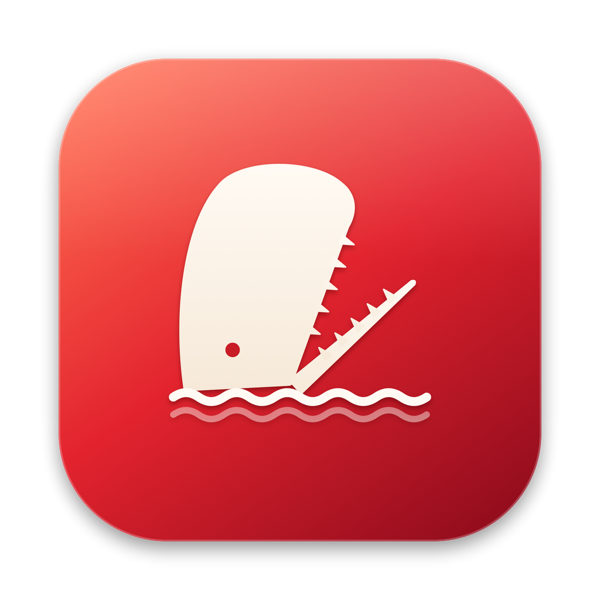
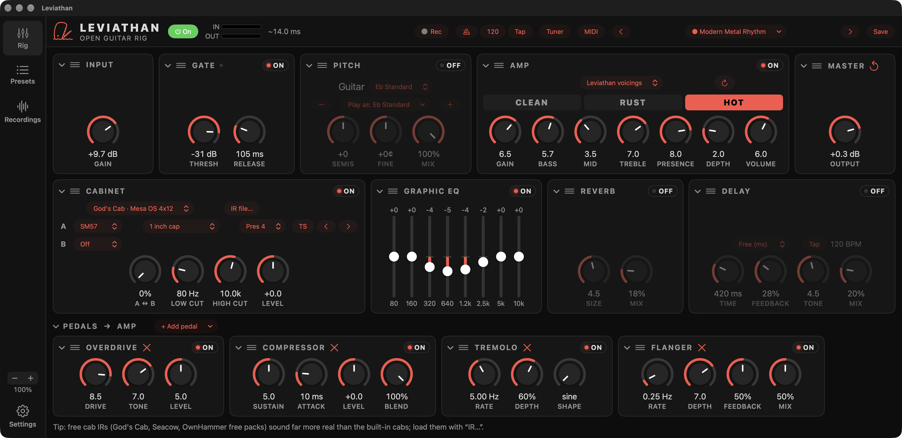
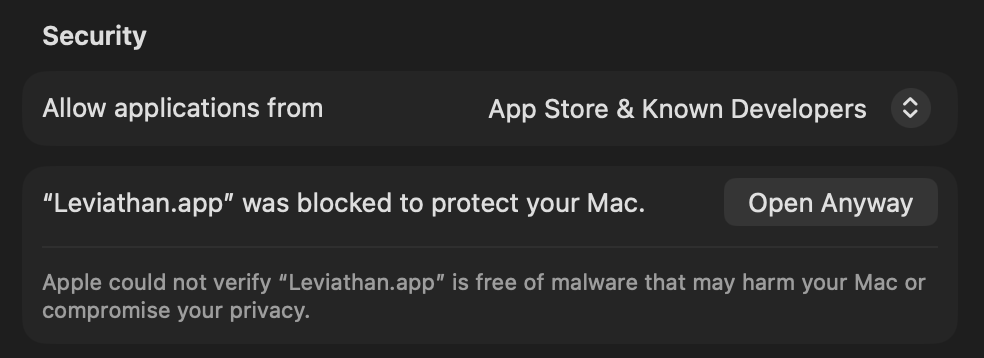

  

<h1 align="center">Leviathan</h1>

<b>A free guitar amp and effects rig for your Mac or Windows PC.</b> 
Plug in your guitar, pick a sound, play. Real amp tones, pedals, cabinets, a tuner and a recorder in one app. No account, no subscription.

  

---

## What you need

- **A Mac** (macOS 13 Ventura or later) **or a Windows PC** (Windows 10 or 11, 64-bit).
- **An audio interface:** the small box you plug your guitar into, such as an iRig, Focusrite Scarlett or Boss Katana over USB.
- **Headphones or speakers.** Plugging headphones into the interface itself sounds best and has the least delay.

## Install

### Mac

1. Download the latest **`Leviathan-x.y.z.dmg`** from the [Releases page](../../releases).
2. Open it and drag **Leviathan** into your **Applications** folder.
3. Double-click **Leviathan** in Applications. The first time, macOS says it "can't be checked" and won't open it. Click **Done**.
4. Open **System Settings → Privacy & Security** and scroll down. Next to *"Leviathan.app" was blocked to protect your Mac*, click **Open Anyway**, then confirm with your password or Touch ID. You only do this once.

   

5. When asked, **allow microphone access**. This is how Leviathan hears your guitar through the interface. macOS remembers your answer, including after updates.

### Windows

1. Download the latest **`Leviathan-Setup-x.y.z.exe`** from the [Releases page](../../releases).
2. Run it. If Windows says *"Windows protected your PC"*, click **More info → Run anyway**.
3. Leviathan appears in your Start menu.

### Updates

Leviathan checks for new versions itself. When one is out, a banner appears at the top of the window: click **Update** and it installs and restarts. You never need to download it again.

## Getting started

1. **Plug your guitar into your audio interface** and connect the interface to your computer.
2. Open Leviathan. In the **Input** panel (top left), **pick your interface** and the input your guitar is plugged into.
3. Press **Start** at the top (or the Space bar).
4. **Pick a sound** from the preset menu at the top, or step through presets with **‹ ›**.
5. Play. Use **Input Gain** to set how hard you hit the amp, and **Output** in the Master panel for the overall volume.

**Not sure what a knob does?** Hover over it. A strip at the bottom of the window explains every knob, slider and button. You can turn this off in **Settings → Appearance**.

**Turning knobs:** drag up or down, or scroll over the knob. Hold **Shift** for fine steps. The **↺** under each knob puts it back to its starting point.

## What's inside

**Amps**
- **Real amps.** Leviathan plays *NAM captures*: recordings of real amplifiers turned into models, similar to Kemper profiles. It comes with 11 of them:
  - Peavey 5150 and 6505+
  - Mesa/Boogie Mark IV
  - Splawn Pro Mod
  - Marshall JVM
  - Laney GH100S
  - ENGL
  - Soldano-style drive
  - Fender Twin

  You can add thousands more for free (see [Getting more sounds](#getting-more-sounds)).
- **Leviathan's own amp** with three channels: Clean, Rust and Hot.

**Effects**
- **Pedals:** compressor, wah (with a pedal or automatic), fuzz, overdrive, chorus, flanger, phaser and tremolo, plus **Blade**: a high-gain distortion inspired by the EAE Longsword, with a 3-band EQ, a mid boost and three clipping modes. Drag pedals into any order.
- **Noise gate** to silence hiss between notes.
- **Pitch / Play as:** play songs in other tunings without retuning, up or down by up to an octave. Every tuning shows its notes, for example "Drop C · C G C F A D".
- **Cabinet:** the speaker and microphone sound. Use the built-in cabinets, or add your own speaker files (IRs) and search through them by band or song.
- **Graphic EQ, delay and reverb.**
- **Master output** that never distorts, however loud you turn it.

**Presets**
- **26 ready-made sounds,** all at a similar volume:
  - **Real-amp presets:** Modern Metal 5150, Groove Chug 6505+, Thrash Rhythm Mark IV, Crunch JVM, Clean Twin and more.
  - **Band-inspired tones:** Metallica-, Slayer-, Pantera-, Megadeth-, Sabbath-, Maiden-, Meshuggah-, Entombed-, Rammstein- and Opeth-ish.
- **Save** your changes to a preset, or **Save as** a new one. Mark favourites with a star.
- **Share presets** as `.leviathan` files. They work on both Mac and Windows; double-click one to load it.

**Practice**
- **Tuner** with standard and alternate tunings.
- **Metronome** with beat lights and tap tempo. The delay can follow the tempo too.

**Recording**
- **Press Rec** to record. Leviathan saves your clean guitar signal and the finished sound side by side, along with the exact settings you used. While you record, the top bar shows the take's waveform.
- **Recordings screen:** listen back, click anywhere on the waveform to jump there, rename and delete takes.
- **Trim takes:** click **✂ Trim**, drag the yellow handles to cut silence or mistakes from the start and end, then **Apply trim**. The original is kept, so **Restore untrimmed** always brings the full take back.
- **Re-amp:** play an old take back through a different sound, live or into a new file, without playing it again.
- **Import** recordings from other apps, single files or whole folders.
- **Takes are never lost.** If the app quits or crashes mid-take, the recording is recovered next time.

**Control with your feet**
- **MIDI footswitches and expression pedals:** click **MIDI** at the top, click a knob or switch, then move the pedal or press the switch you want to use. Switches can turn effects on and off, change presets, tap the tempo, or open the tuner.

**Layout**
- Panels can be dragged into any order and folded away with the arrow on each one.
- The window remembers its size. Zoom in or out with the **− +** buttons at the bottom left.

## Getting more sounds

Leviathan uses two kinds of sound file:

| Kind | What it is | File | How to add it |
| --- | --- | --- | --- |
| **NAM capture** | A real amp, pedal or whole rig | `.nam` | **Amp → Add .nam…** |
| **Impulse response (IR)** | A speaker cabinet and microphone | `.wav` | **Cabinet → Add IRs…** (files or a whole folder) |

**Where to get amps (`.nam` files)**
- [TONE3000](https://www.tone3000.com): thousands of free amps, pedals and rigs. When searching, choose **NAM**. Tones marked **IR** are cabinets and download as `.wav` files.
- [pelennor2170/NAM_models](https://github.com/pelennor2170/NAM_models): a big free collection, where Leviathan's own amps come from. Click **Code → Download ZIP** to get them all, then unzip.
- [Neural Amp Modeler](https://www.neuralampmodeler.com): the project behind NAM, with links to more.

**Where to get cabinets (`.wav` files)**
- [TONE3000](https://www.tone3000.com): free cabinets and band-tone packs (choose **IR**).
- [OwnHammer](https://www.ownhammer.com) and [ML Sound Lab](https://ml-sound-lab.com): free and paid cabinet packs.
- *God's Cab*: a free, popular Mesa 4x12 pack with many microphones, which Leviathan has its own browser for. Search for "God's Cab IR" to find a copy, and put it in the God's Cab folder listed under [Where your files are](#where-your-files-are).

**Tip:** some amp captures are "full rig" captures that already include a cabinet. For those, switch Leviathan's **Cabinet** off.

## Sounding your best

- **Stop your interface from distorting.** Turn the gain knob *on your interface* down until your hardest playing never lights it red. A distorting interface makes every sound harsh and fizzy. Leviathan warns you when this happens; use **Input Gain** in Leviathan if you need more level.
- **Listen through your interface.** Headphones or speakers plugged into the interface have the least delay and the fewest crackles.
- **Avoid slow outputs.** Bluetooth headphones, TV or monitor speakers, and laptop speakers all add noticeable delay. The number at the top (for example *~9 ms*) shows the delay. It turns orange when it's high; hover over it to see why.
- **Crackles?** Go to **Settings → Audio** and choose a larger buffer. On Windows, choose your interface's **ASIO** driver if it has one.

## Keyboard shortcuts

| Mac | Windows | Action |
| --- | --- | --- |
| Space | Space | Start / stop sound |
| ⌘R | Ctrl+R | Record / stop recording |
| ⌘S | Ctrl+S | Save the current preset |
| ⇧⌘S | Ctrl+Shift+S | Save as a new preset |
| T | T | Show / hide the tuner |
| ⌘= ⌘− ⌘0 | Ctrl+= Ctrl+− Ctrl+0 | Zoom in / out / normal size |
| Return | Enter | Play / pause (Recordings) |
| Delete | Delete | Delete the selected recording |

## Where your files are

| What | Mac | Windows |
| --- | --- | --- |
| Recordings | `~/Music/Leviathan/Sessions/` | `Music\Leviathan\Sessions\` |
| Your amp captures (`.nam`) | `~/Library/Application Support/Leviathan/NAM/` | `%APPDATA%\Leviathan\NAM\` |
| Your cabinet files (IR library) | `~/Library/Application Support/Leviathan/IRs/Library/` | `%APPDATA%\Leviathan\IRs\Library\` |
| God's Cab pack | `~/Library/Application Support/Leviathan/IRs/GodsCab/` | `%APPDATA%\Leviathan\IRs\GodsCab\` |
| Settings and presets | `~/Library/Preferences/local.leviathan.ampsuite.plist` | `%APPDATA%\Leviathan\Leviathan.settings` |

**Opening these folders:**
- **Mac:** in Finder, press **⇧⌘G** and paste the path.
- **Windows:** paste the path into the File Explorer address bar.
- **Either:** use **Open folder** in **Settings → Library**.

## Help and feedback

Found a problem or have an idea? In Leviathan, go to **Settings → Help & feedback**. It opens a form with your setup already filled in. You can also [open an issue on GitHub](https://github.com/shaneoreilly/leviathan-amp-suite/issues/new/choose).

## Credits and license

- The included amp captures were made by members of the Neural Amp Modeler community; see [CREDITS.md](shared/nam/captures/CREDITS.md).
- The logo is based on a classic public-domain *Moby-Dick* illustration.
- Other software used by Leviathan is listed in [NOTICE.md](NOTICE.md).

Leviathan is free, open-source software by Shane O'Reilly, under the [GNU AGPLv3](LICENSE) license with the extra terms in [NOTICE.md](NOTICE.md). You can use it, share it and change it. Anything made from it must also be open source and keep the credit "Leviathan by Shane O'Reilly".

Building Leviathan yourself, or want to contribute? See [DEVELOPMENT.md](DEVELOPMENT.md).
